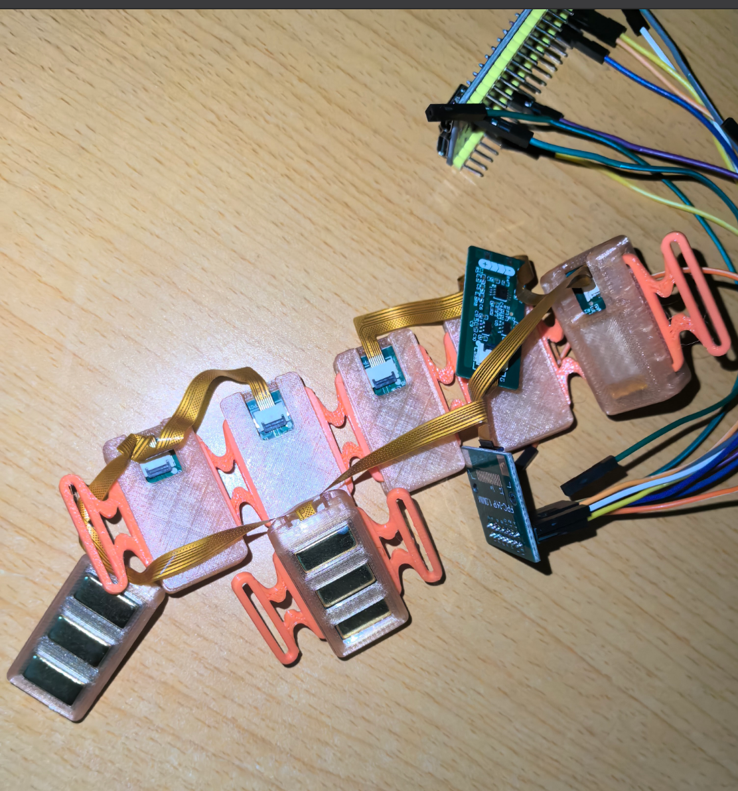
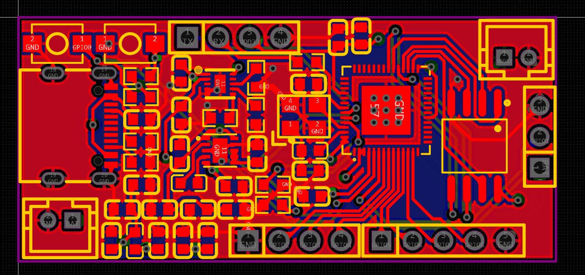
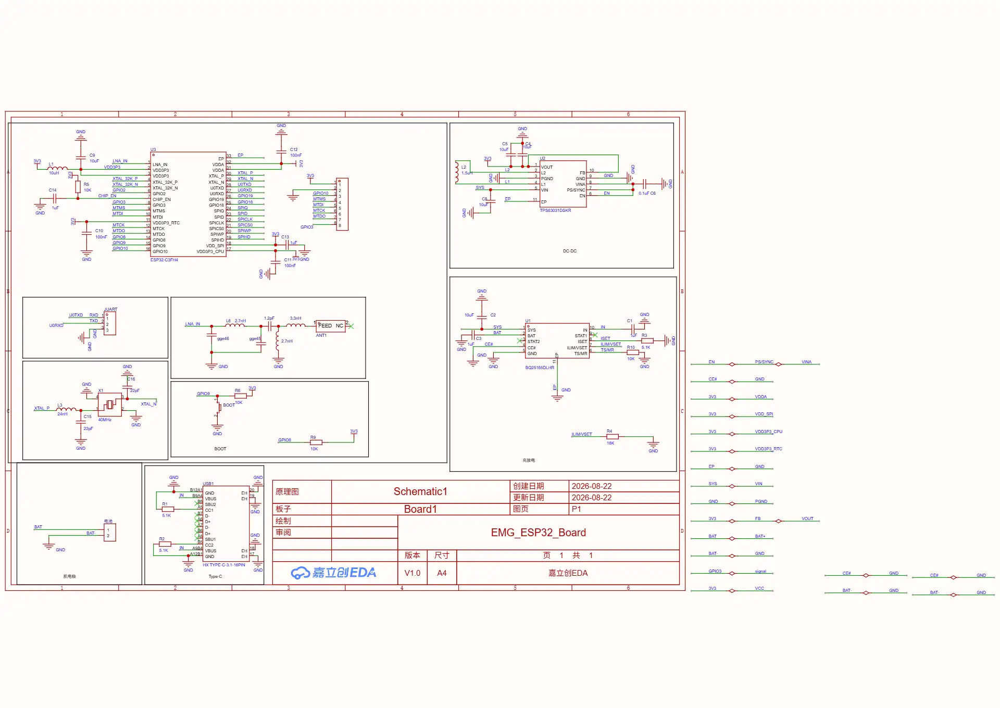
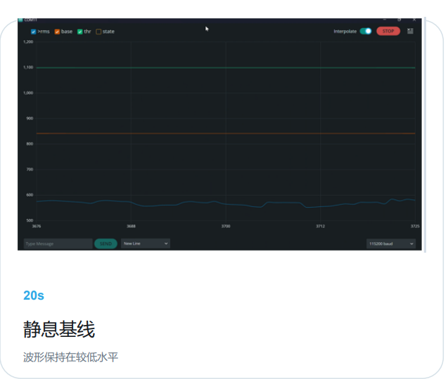
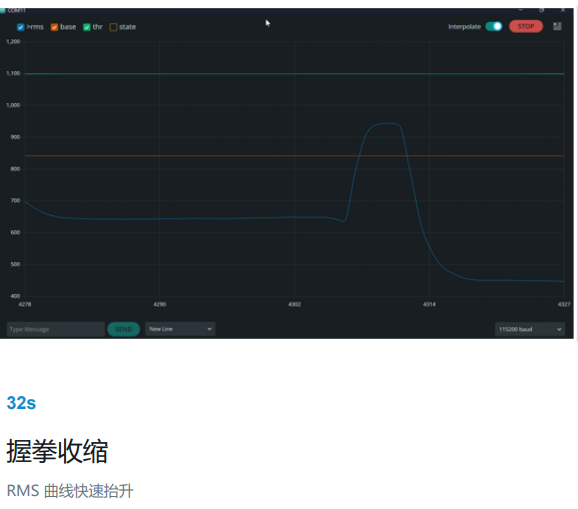
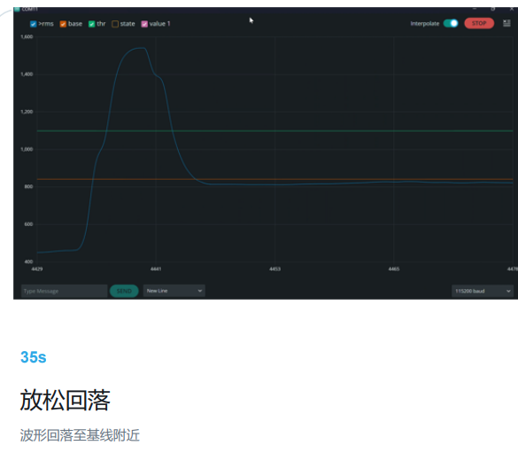

# ESP32-S3 八通道无线肌电采集系统

**最终成品实物照片**

**最新主控 PCB 布局（2026-11-13）**

最新主板工程：`hardware/main_controller/mainboard_2026-11-13_latest.epro2`。之前日期的工程保留为设计迭代记录。

**较早版本主控原理图预览（图中标注 ESP32-C3；仅作为设计迭代记录）**

## 肌电信号演示

以下为项目实测串口曲线截图，依次展示静息、握拳收缩和放松后的变化。静息时 RMS 曲线保持在较低水平；握拳时 RMS 快速升高并越过阈值；放松后波形回落至基线附近。图中数值是当次实验的串口读数，不能直接视为经过标定的肌电电压或跨设备性能指标。

### 静息基线

### 握拳收缩

### 放松回落

这是一个基于 ESP32-S3 的肌电采集与握拳活动识别项目，包含模拟前端、ADS131M08 八通道采集硬件设计、独立 Wi-Fi 模块设计，以及单通道和八通道采集程序原型。项目已演示肌肉收缩与静息时信号幅值的变化；八通道 ADC 与 Wi-Fi 程序已纳入仓库，但尚未经实机验证。

## 实现了什么

### 当前固件已实现

- 使用 ESP32-S3 内置 ADC 从一个模拟输入脚采集肌电信号（代码配置 GPIO3）。
- 按 1 kHz 目标采样节拍读取信号。
- 依次进行 50 Hz 陷波、20 Hz 高通和 250 Hz 低通数字滤波。
- 以 100 ms 滑动窗口计算 RMS，每 20 ms 更新一次。
- 上电后用 2 秒静息信号建立基线，并通过开启/释放双阈值和连续窗口确认判断肌肉活动状态。
- 通过 115200 波特率串口输出 RMS、基线、阈值和状态，便于串口监视器观察。

### 八通道与无线原型

`firmware/esp32_s3_8ch/` 提供 ADS131M08 八通道采集原型：读取八路 ADC 数据，沿用数字滤波、滑动 RMS、静息基线及阈值状态判断，并通过 UART 输出带时间戳的 CSV 行。`firmware/esp8266_wifi_udp/` 提供 ESP8266EX 转发原型：逐行读取 UART CSV，并将每行作为一个 UDP 数据包发送。

### 硬件设计包含

- 肌电模拟前端：EDA 工程中可见 INA333、OPA333 与电极符号。
- 八通道 ADC 方案：ADS131M08 及其时钟和输入连接器设计。
- ESP32-S3(R8) 主控板与外部 Flash 的后续版本；更早的工程包含 ESP32-C3 版本。
- 独立 ESP8266EX Wi-Fi 模块设计。项目目标描述了主控与 Wi-Fi 模块通过 UART 连接，并使用 UDP 传输。

## 已核实硬件

- 肌电前端工程包含 INA333（U1）、OPA333（U5/U6）和三枚电极符号；阻容标号可见，但实际阻容数值未可靠提取。
- ADC 工程包含 ADS131M08、8.192 MHz 时钟器件和八路输入连接器。
- 最新主控工程为 2026-11-13；PCB 预览见上图。工程数据尚待逐项核对器件/BOM。已解析的 2026-10-29 主控工程使用 ESP32-S3(R8) 与 XT25F16 外部 Flash；较早的 2026-10-25 版本使用 ESP32-C3FH4，代表不同迭代。
- Wi-Fi 工程包含 ESP8266EX、W25Q80 外部 Flash 和板载天线符号；项目描述为 UART 接主控、UDP 传数据。

## 仓库导航

- `docs/hardware.md`：硬件组成、工程版本与已确认元件。
- `docs/communication.md`：已知数据链路及待确认协议参数。
- `docs/software.md`：软件状态和复现资料清单。
- `hardware/`：EDA Pro 原始工程归档。
- `docs/images/emg_finished.png`：成品照片。

## 贡献

欢迎通过 Issue 讨论问题或提交 Pull Request。硬件修改请提供对应工程版本、复现步骤及变更说明。

## 许可证

硬件设计文件按 CERN-OHL-W-2.0 授权，软件源代码按 MIT 授权。其他文档、照片及第三方材料不自动包含在这两项许可中；详情见根目录 `LICENSE` 和 `LICENSE.hardware` / `LICENSE.software`。
